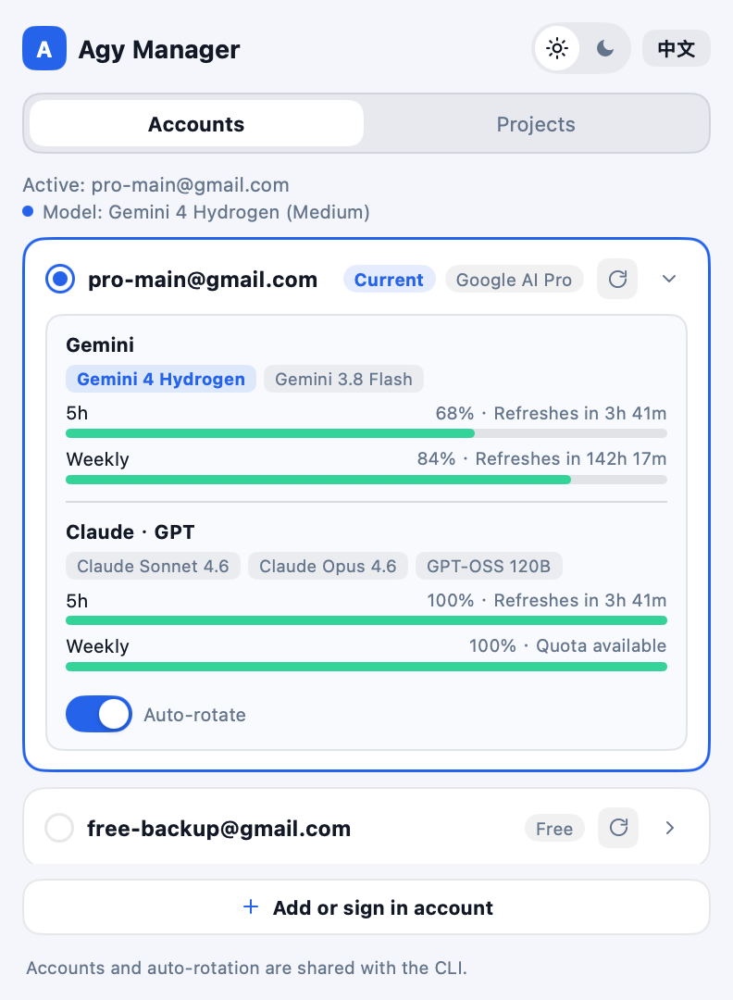
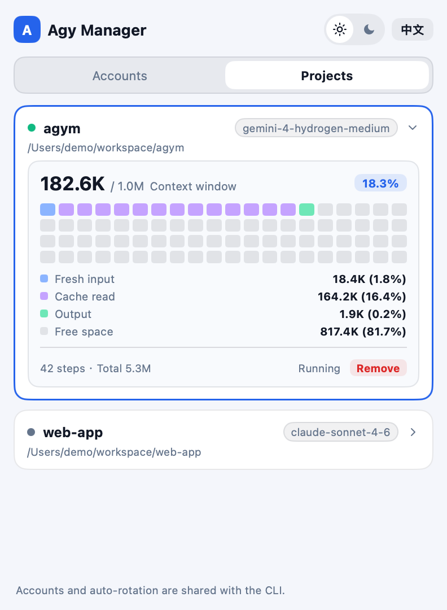

# agym

[简体中文](./README.zh-CN.md) | English

A lightweight, pure-Go menu bar tray app and CLI for managing multiple `agy` Google accounts, monitoring Gemini/Claude quota windows, tracking per-workspace context window & token usage, and safely switching Keychain credentials.

Built as a single pure-Go binary with [MyGo](https://github.com/egoist/mygo) native GPU UI (macOS Metal / Windows Direct3D 11) — **zero WebView processes** and **zero CGO**.

## Screenshots

| Accounts | Projects |
| :---: | :---: |
|  |  |

## Features

- **Pure-Go Native GPU UI & CLI in One Binary**: Run `agym` (or `agym ui`) for the borderless menu bar popover, or invoke subcommands directly from the terminal. No `WKWebView` or browser helper processes.
- **Accounts & Grouped Model Quotas**:
  - Displays `Gemini` and `Claude · GPT` quota groups separately with supported model tags, `5h` / `Weekly` progress bars, reset countdowns, and subscription tiers (`Free` / `Google AI Pro` / `Ultra`).
  - Highlights the active global `agy` model from `~/.gemini/antigravity-cli/settings.json`.
  - Per-card `↻` refresh button, automatic background refresh on tray open (current account prioritized first), and zero-delay optimistic account switching.
- **Projects Context & Token Monitor**:
  - Dedicated **Projects** tab showing active (`Running`) and idle `agy` workspaces with an 80-cell (20×4) dot-matrix context window breakdown (`Fresh input`, `Cache read`, `Output`, `Free space`), cumulative tokens, and step counts.
  - Incremental `transcript.jsonl` caching (`mtime + offset`) with 5-second live polling while viewing, plus one-click project dismissal (automatically re-appears when `agy` runs again in that workspace).
- **Safe Keychain Switching & OAuth Onboarding**: Stores account backups under `gemini-agy-backup/<email>` in macOS Keychain with a cross-process `slot.lock`. Supports in-tray official `agy` OAuth sign-in. Raw tokens never leave the backend.
- **Light / Dark Theme & Bilingual UI**: Built-in Sun/Moon theme toggle and `EN` / `中文` language toggle.
- **Session Handoff Supervisor**: Optional CLI `supervise` mode + Stop hook for mid-conversation quota-exhaustion account rotation in external terminals.

## Why Native PTY + Supervisor (vs. ACP Clients)

| Dimension | `agym` (Native PTY + Supervisor & Pure-Go UI) | ACP-Based Clients |
| :--- | :--- | :--- |
| **Fidelity & Features** | Runs the official `agy` binary directly in a real PTY — 100% native tool approvals, MCP output, slash commands, shortcuts, and TUI rendering with zero protocol loss. | Must translate agent events into generic JSON-RPC messages and redraw UI; newly added CLI behaviors often lag or lose detail. |
| **Multi-Account Rotation** | Built-in parent supervisor + Keychain slot swapping + Stop hook detection: automatically switches to a healthy account with remaining quota mid-conversation and resumes the exact `--conversation=<id>`. | Supports configuring multiple instances and switching manually, without automatic mid-conversation quota-exhaustion handoff. |
| **Cross-Account & Project Awareness** | Aggregates per-account tiers (`Ultra`/`Pro`/`Free`), grouped model catalogs, active model, and live per-workspace context window / token usage in one lightweight tray app. | Probes quota per configured instance without unified cross-account comparison or live workspace context-window monitoring. |
| **Zero Overhead & Upgrade-Safe** | Zero extra system prompts or wrapper token overhead, and zero WebView helper processes; immune to upstream `agy` UI/model/tool updates as long as CLI flags and Stop hooks remain intact. | May inject adapter prompts/tool schemas and requires protocol schema updates as upstream CLIs evolve. |

## Prerequisites

- **macOS** (Apple Silicon / Intel) or **Windows**
- Official `agy` CLI installed (expected at `~/.local/bin/agy`)

## Installation

### Quick Install (`curl`)

```sh
curl -fsSL https://raw.githubusercontent.com/GongJS/agym/main/install.sh | sh
```

### From Source

```sh
git clone https://github.com/GongJS/agym.git
cd agym
make build
cp dist/agym ~/.local/bin/agym
```

## Usage

### Menu Bar Tray

```sh
# Launch the menu bar UI (default when no subcommand is given)
agym
# or explicitly
agym ui
```

### CLI Commands

```sh
agym accounts                 # Print safe account metadata as JSON
agym who                      # Print the active agy account
agym switch <email>           # Switch the live Keychain login to a saved account
agym quota [--refresh]        # Print cached quota JSON (or force refresh)
agym add <email>              # Add an existing Keychain backup to the roster
agym remove <email>           # Remove from roster (keeps Keychain backup)
agym rotation <email> on|off  # Toggle automatic-rotation membership
agym install-hook             # Install the quota handoff Stop hook
agym remove-hook              # Remove the agym Stop hook
agym supervise [--pinned] [--] <agy args...>
```

### Session Handoff (Optional)

Daily menu bar tray usage and manual switching (`agym switch`) do **not** require installing any hook.

If you want `agym supervise` to automatically rotate accounts when a terminal session hits a quota limit, register the Stop hook once:

```sh
agym install-hook
agym supervise --model <model-id>
```

To remove the hook later, run `agym remove-hook`.

## Documentation

- [Architecture & Security Model](./docs/architecture.md)
- [Development & Release Guide](./docs/development.md)
- [Contributing](./CONTRIBUTING.md)
- [Security Policy](./SECURITY.md)

## License

[MIT](./LICENSE)
