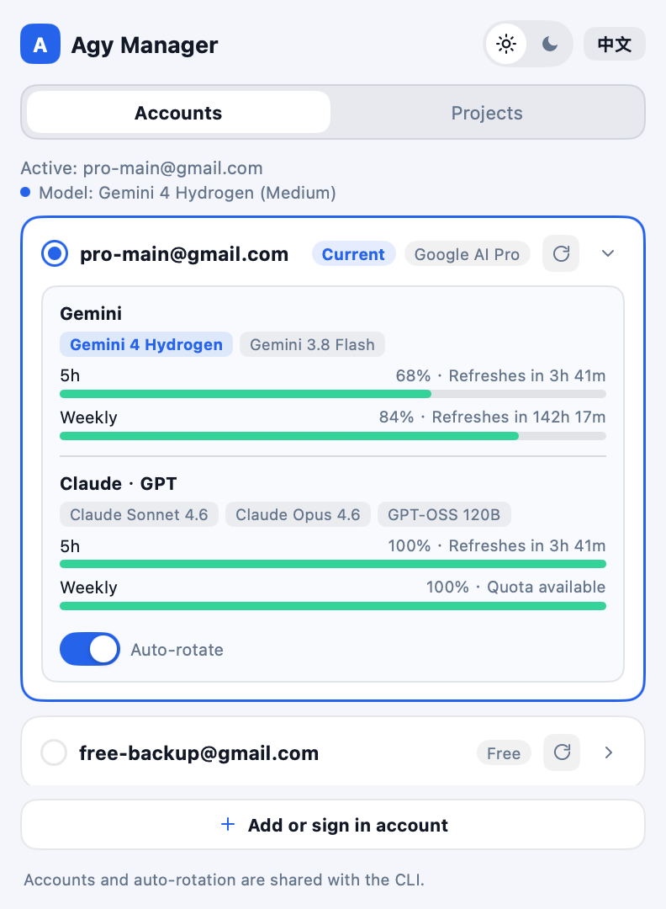
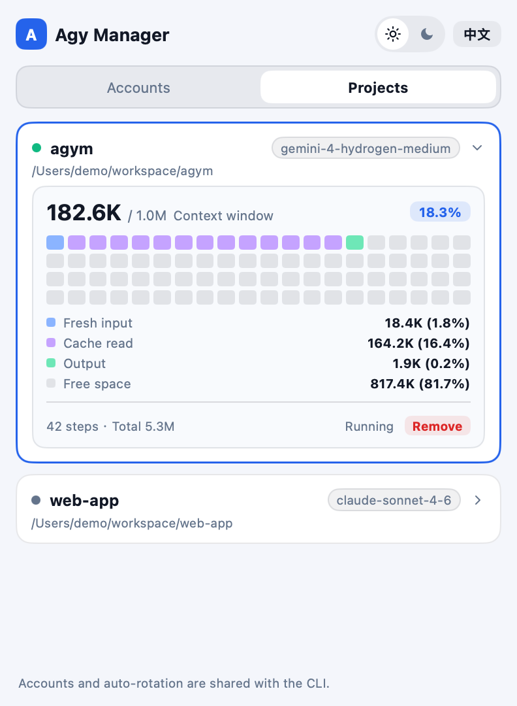

# agym

简体中文 | [English](./README.md)

面向 `agy` 的轻量级纯 Go 多账户与项目上下文管理工具：提供菜单栏托盘弹窗与命令行 CLI（单二进制分发），支持安全切换登录态、分组查看 Gemini/Claude 配额窗口、实时监控各项目上下文窗口与 Token 占用。

基于纯 Go 与 [MyGo](https://github.com/egoist/mygo) 原生 GPU UI（macOS Metal / Windows Direct3D 11）构建——**无 WebView 子进程**、**零 CGO**。

## 界面预览

| 账户管理（Accounts） | 项目监控（Projects） |
| :---: | :---: |
|  |  |

## 核心特性

- **纯 Go 原生 GPU UI + CLI 单二进制**：直接运行 `agym`（或 `agym ui`）启动无边框菜单栏浮窗，带子命令时作为 CLI 使用；彻底摆脱 `WKWebView` 与浏览器辅助进程。
- **账户与模型分组配额**：
  - 按 `Gemini` 与 `Claude · GPT` 两组分别展示支持的模型标签、`5 小时` / `每周` 配额进度条、重置倒计时与订阅等级（`Free` / `Google AI Pro` / `Ultra`）。
  - 自动读取 `~/.gemini/antigravity-cli/settings.json` 中的当前模型，在顶部与对应模型胶囊处高亮显示。
  - 每张账户卡片配有独立的 `↻` 刷新按钮；每次打开托盘后台静默刷新一次（当前账户优先返回），切换账户支持乐观更新零卡顿。
- **项目上下文与 Token 实时监控**：
  - 独立「项目」Tab 展示各工作区运行状态（运行中 / 空闲）、80 格（20×4）上下文点阵图（`新增输入`、`缓存命中`、`模型输出`、`剩余空间` 数量与占比）、步数及累计 Token。
  - 基于 `mtime + offset` 增量解析 `transcript.jsonl`，停留在项目 Tab 时每 5 秒刷新当前列表状态；支持移除项目卡片（项目再次运行 `agy` 时自动去重恢复）。
- **安全的钥匙串切换与官方 OAuth 登录**：通过 macOS Keychain（`gemini-agy-backup/<email>`）备份多账号登录态并配合 `slot.lock` 跨进程锁切换，支持托盘内直接拉起官方 OAuth 登录，原始凭据不离开后端。
- **浅色 / 深色主题与中英双语**：右上角提供太阳/月亮主题切换按钮与 `EN` / `中文` 一键切换。
- **会话额度接力（CLI）**：提供 `supervise` 与 Stop Hook，在外部终端中遇到严格配额耗尽事件时自动切换健康账户并续跑原会话。

## 核心优势：原生 PTY + Supervisor（对比 ACP 客户端）

| 对比维度 | `agym`（原生 PTY + Supervisor & 纯 Go UI） | 基于 ACP 协议的客户端 |
| :--- | :--- | :--- |
| **保真度与功能完整度** | 在真实 PTY 中直接运行官方 `agy` 二进制——工具审批、MCP 输出、斜杠命令、快捷键与 TUI 渲染 100% 原汁原味，零协议损耗。 | 需要把 Agent 事件转译为通用 JSON-RPC 并重绘 UI，官方 CLI 新增能力往往滞后或丢失细节。 |
| **多账户自动接力轮换** | 内置父进程守护 + Keychain 槽位切换 + Stop Hook 检测：对话中途配额耗尽时自动切到有余量的健康账户，并用 `--conversation=<id>` 无缝续跑原会话。 | 通常只支持配置多个实例并手动切换，缺少会话中途配额耗尽后的自动无感接力。 |
| **跨账户与项目全局感知** | 在单个轻量托盘内聚合所有账户的套餐等级（`Ultra`/`Pro`/`Free`）、分组模型目录、当前激活模型以及各工作区的上下文窗口/Token 实时占用。 | 仅按单个配置实例探测配额，缺少跨账户横向对比与项目级上下文窗口实时监控。 |
| **零额外开销 & 抗升级** | 不注入任何额外系统提示词或包装工具 Token，也无 WebView 进程开销；只要上游 CLI 参数与 Stop Hook 保持兼容即可直接跟随官方升级。 | 可能注入适配提示词/工具 schema，且上游 CLI 演进时需要同步维护协议映射。 |

## 环境要求

- **macOS**（Apple Silicon / Intel）或 **Windows**
- 已安装官方 `agy` CLI（默认路径 `~/.local/bin/agy`）

## 安装

### 一键脚本安装（`curl`）

```sh
curl -fsSL https://raw.githubusercontent.com/GongJS/agym/main/install.sh | sh
```

### 从源码编译

```sh
git clone https://github.com/GongJS/agym.git
cd agym
make build
cp dist/agym ~/.local/bin/agym
```

## 使用方法

### 启动菜单栏托盘

```sh
agym
# 或显式指定
agym ui
```

### 常用 CLI 命令

```sh
agym accounts                 # 以 JSON 输出账户元数据（不含凭据）
agym who                      # 查看当前活跃 agy 账户
agym switch <email>           # 切换到已保存的账户
agym quota [--refresh]        # 查看缓存额度（加 --refresh 立即刷新）
agym add <email>              # 将钥匙串已有备份加入管理名单
agym remove <email>           # 从名单移除（保留钥匙串备份）
agym rotation <email> on|off  # 开启/关闭自动轮换
agym install-hook             # 安装额度接力 Stop hook
agym remove-hook              # 移除 agym Stop hook
agym supervise [--pinned] [--] <agy args...>
```

### 会话额度接力（可选）

日常使用菜单栏托盘与手动切换账号（`agym switch`）**不需要**安装任何 hook。

仅当你希望在终端中使用 `agym supervise` 启动会话，并在遇到配额耗尽时自动切号续跑，才需要执行一次：

```sh
agym install-hook
agym supervise --model <model-id>
```

如需卸载该钩子，随时执行 `agym remove-hook` 即可。

## 相关文档

- [架构设计与安全边界](./docs/architecture.md)
- [本地开发与发布指南](./docs/development.md)
- [贡献指南](./CONTRIBUTING.md)
- [安全策略](./SECURITY.md)

## 开源协议

[MIT](./LICENSE)
